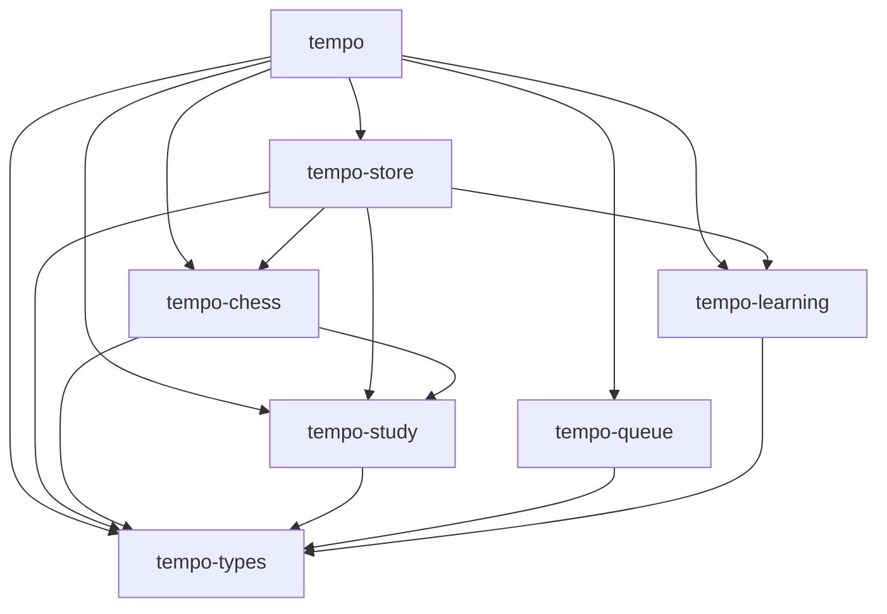

# Tempo 2: ownership and dependencies

Contract baseline v0.1 · 2026-11-17

Tempo 2 uses separate Git repositories, small Rust libraries, one application
process, and one SQLite database. This document defines ownership and permitted
dependencies. The executable interface scaffold is specified in
[INTERFACES.md](INTERFACES.md); its real and fixture implementations are identified
there. Concrete acceptance expectations live in [BEHAVIOR.md](BEHAVIOR.md).

## Ownership

| Repository | Owns | Public output |
| --- | --- | --- |
| [tempo-types](https://github.com/tempo-v2/tempo-types) | Opaque identifiers, content versions, a small semantic outcome vocabulary | Shared value types |
| [tempo-study](https://github.com/tempo-v2/tempo-study) | Exercise/attempt progression; question-source and grader interfaces | Progress, feedback, optional terminal assessment |
| [tempo-queue](https://github.com/tempo-v2/tempo-queue) | Eligibility, new introductions, ordered blocks, next selection | Eligible targets and ordered selections |
| [tempo-learning](https://github.com/tempo-v2/tempo-learning) | Learning state, scheduler adaptation, daily credit, repeat obligations | Proposed learning-state changes |
| [tempo-chess](https://github.com/tempo-v2/tempo-chess) | Position identity, PGN, repertoire/tactic content, chess graders, pure game comparison | Validated content, content differences, assessments/feedback |
| [tempo-store](https://github.com/tempo-v2/tempo-store) | SQLite schema, constraints, migrations, mappings, consistent reads and transaction mechanism | Stored domain values and committed results |
| [tempo](https://github.com/tempo-v2/tempo) | Application commands, dependency assembly, transaction orchestration, transport and provider access | Application/API responses |
| [tempo-core-components](https://github.com/tempo-v2/tempo-core-components) | Presentation components: board, controls, dialogs | Rendered views and user intent |
| [.planning](https://github.com/tempo-v2/.planning) | Cross-repository engineering decisions, shared examples, local setup | Documentation and development tooling |

`tempo-chess` initially contains private position, PGN, repertoire, tactics and
grading modules. `tempo-types` stays small: rich learning state, queue inputs,
chess content and database rows belong to their owning repositories.

## Permitted production dependencies

An arrow means **imports**, not the direction of runtime requests. These are
allowed edges; a crate adds an edge only when its implementation needs it.
The initial interface scaffold now declares the edges it uses; the architecture
gate checks all dependency kinds against the permitted graph.

Study, Queue and Learning depend only on the shared vocabulary among Tempo
crates. Chess implements Study's grader interface. Store depends on public
domain types to persist them; domain crates do not import Store. UI components
receive view data and emit input; the application owns their transport adapter.
`.planning` has no runtime dependency role.

The shared architecture gate enforces allowed direct dependencies and repository
source boundaries. Ordinary Study, Queue, Learning and Chess unit tests require
neither the full application nor a database/browser/provider. Real transaction
and application journeys are tested at those boundaries.

## Interfaces and authority

**Question source.** Study defines the source interface. An application-owned
adapter reads content/learning facts, converts them to Queue's own candidate
inputs, asks Queue for a selection, and resolves its content and grader. Study
can therefore ask for the next exercise without importing Queue or Chess. The
source distinguishes ready, empty-for-now, and operationally unavailable.

**Grading.** A grader accepts exercise-specific state and input and returns
feedback, next state, an optional terminal assessment, and presentation status.
One attempt has at most one terminal assessment. Failure can become final while
the explanation or correction continues. Persist the grading scheme, content
version and state, then reconstruct the implementation; do not persist a
callback. A small chess-grader enum may implement the generic Study trait.

**Learning.** Assessment describes performance. Learning decides whether it
advances a schedule, clears a repeat, or records practice. Programmatic Again
uses the same application learning operation with source provenance and a stable
source-event identity; it does not fabricate a human Study attempt. Time and
policy are explicit inputs to domain decisions.

**Queue.** Expose eligibility separately from grouping and ordering. Eligibility
uses active content and learning facts; ordering cannot invent eligibility.
Shuffle/order blocks as units and preserve their internal order. Durable due,
introduction and repeat facts belong to Learning. Queue order is rebuildable.

**Persistence.** The application defines the atomic operation. Store supplies
the transaction mechanism and typed persistence operations. Accepting a response
saves progress and, when present, its terminal assessment and learning effect
together. Stable submission identities make replays harmless. Content-version,
dataset and latest-miss checks protect against stale work. A raw database handle
or universal mutable application context is not a domain interface.

## Content and learning identity

- A repertoire learning target is `(repertoire, canonical position)`. Every
  represented learner decision has one prescribed response, enforced with real
  relational keys. Transpositions and repeated occurrences share that target.
- A tactic is one learning target, even when its solution asks several questions.
  A repertoire block contains separate position exercises and schedules.
  Autoplayed context earns no learning credit.
- Preserve finite ordered line occurrences alongside the position graph. Chess
  graphs can contain cycles. Canonical repertoire identity ignores move counters
  and preserves side to move, castling and legally effective en-passant rights,
  using one chess-library-backed canonicalizer.
- Content edits report semantic differences. Changed prescribed answers reset
  current learning for a new content version while retaining history; metadata
  edits preserve progress. The application commits content and learning changes
  together. Importing content and restoring current progress are distinct
  operations.
- Fetching games, coverage analysis, content editing and export/restore sit
  around the Study loop. Optional provider work is never an admission condition
  for ordinary Study. Game scans update future selection, not the active exercise.

## Development workspace and releases

The setup script clones sibling Git repositories under a local virtual Cargo
workspace. The parent directory is not a Git repository. Its `Cargo.toml`, shared
`Cargo.lock` and `target/` are local development infrastructure; UI and planning
repositories are excluded from Cargo membership. Package manifests contain their
own metadata and can stand alone outside that parent.

The interface scaffold uses exact package version requirements and explicit
root-local Cargo patches to the sibling checkouts. These packages have not been
published as releases. Setup verifies their local source identity. Release
consumption will select a compatible published version or an immutable Git
revision; shared public types must resolve to a consistent source/version. Local
path overrides belong in local development configuration, not the release
contract. Workspace membership alone does not override versioned dependencies.

Component releases carry their focused test evidence. Application adoption tests
the affected contracts and real integration path. Toolchain, feature or dependency
changes require reassessing the relevant evidence. Building empty scaffolds
proves setup only. Qualification of the wired scaffold adds executable contract
evidence; real chess algorithms and SQL durability require their own acceptance.

## References

- [Cargo workspaces](https://doc.rust-lang.org/cargo/reference/workspaces.html)
- [Cargo dependency sources](https://doc.rust-lang.org/cargo/reference/specifying-dependencies.html)
- [Cargo version/type compatibility](https://doc.rust-lang.org/cargo/reference/resolver.html#version-incompatibility-hazards)
