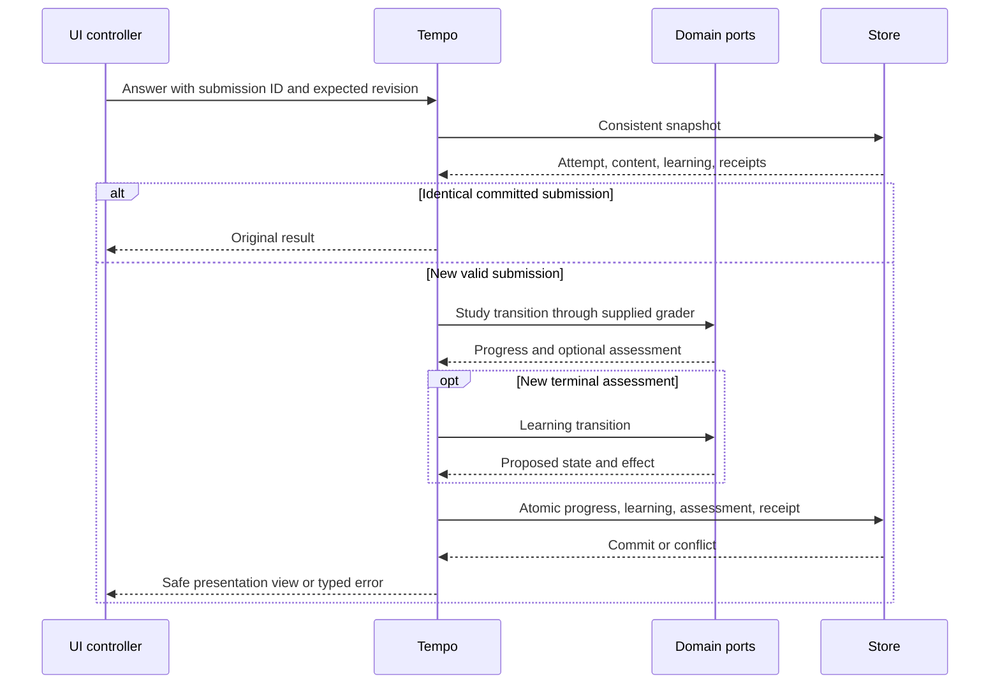

# Tempo 2: first complete interface scaffold

Contract version 0.1 · 2026-11-17

**Scope: historical scaffold.** This records the first executable composition,
including wire version 1, its four-command surface, fixture implementations and
the earlier placement of controller/validator code in Core. It is not the current
production wire inventory or ownership map. Tempo UI now owns application
interaction and recovery; Core supplies reusable presentation components.

For new work, begin with [canonical agent guidance](agent-guidance/AGENTS.md),
the current release/workspace ledger and the owning component's accepted contract
at the selected source revision. A “safe view” can contain identity, authoritative
state/results, delivery facts and display metadata. Visibility to a consumer does
not make those values interchangeable or authorize new policy based on them.
Retain the historical examples below as scoped evidence rather than copying
their defaults into a different runtime.

## Purpose and acceptance

This increment connects every current component through executable public
interfaces. The acceptance target is a complete journey with replaceable
algorithms: select an exercise, issue an attempt, accept input, grade it, update
learning, commit once, and return a presentation view. Content import, content
changes, game feedback, export and restore have separate entry points.

The compiler checks compatible types and the permitted dependency graph. Contract
tests check the behavior that types alone cannot establish. This is evidence that
the initial boundaries work; it is not a promise that no future feature will
require an interface version change.

## Minimum surface of each component

| Component | Public contract | Working implementation now | Replace behind the contract |
| --- | --- | --- | --- |
| `tempo-types` | Distinct dataset, target, attempt, submission and event IDs; content/response/miss versions; Study time and `Grade` | Shared value types and serialization | No business policy belongs here |
| `tempo-study` | `QuestionSource`, `Grader`; `Exercise`, `Attempt`, `Progress`; `next`, `submit`, `abandon` | Generic progression, expected revision, sticky terminal result, separate presentation completion | Exercise-specific source and grader |
| `tempo-queue` | `QueuePolicy`; candidate facts and lines; eligibility; groups/blocks; `QueueOrderContext`; selection and order validation | Eligibility and grouping invariants; interchangeable stable/reversed block policies | Random ordering and 5–10-exercise repeat spacing |
| `tempo-learning` | `LearningPolicy::{settings,validate_state,apply}`; `Scheduler::{settings,validate_memory,schedule}`; proposed `Transition` | Daily credit, immediate Again, repeat and stale-positive rules; fixed interval scheduler | FSRS or another scheduler |
| `tempo-chess` | Typed catalog/lines/definitions; `GradingScheme`; `ExactSequenceGrader`; `ContentParser`, `PositionCanonicalizer`, `GameComparator`; `plan_import` | Sequence matching, semantic changes, shared-target validation, provenance/quarantine rules; registered-input fixtures | Real chess library, PGN processing, canonicalization, game comparison |
| `tempo-store` | Consistent `Snapshot`; typed `Write` batch; `Store::commit` with expected dataset/revision | Atomic in-memory implementation with conflict, receipt, assessment and reference checks | SQLite transactions, schema, constraints, migrations and durable recovery |
| `tempo` | `Tempo::{next_exercise,resume,submit,abandon,again,import_pgn,ingest_games,export,restore}`; composition and UI mapping | All orchestration, source adapter, atomic command handling; JSON-line transport | Production transport and adapters |
| `tempo-core-components` | Versioned view/intent types; `validateStudyView`, `renderStudy`, `createStudyController`; injected `transport.send` | View validation, escaped HTML, busy/retry behavior, real Rust round trip | Board graphics, styling, event binding and browser transport |
| `.planning` | Ownership, these interfaces, behavioral examples, dependency gate, setup and qualification tools | Engineering contract and checks | No runtime role |

`tempo` additionally owns `GameProvider`, `SnapshotCodec`, `Clock`, and
`AttemptIds`. Fixture providers, JSON snapshots, fixed time and counter IDs are
explicit substitutions. Counter IDs are suitable for a fresh in-memory demo;
the production adapter must issue identities unique across restarts.

## Ownership and direction

The allowed import graph is in [ARCHITECTURE.md](ARCHITECTURE.md) and the
machine-readable [dependency rules](contracts/dependencies.json). Domain crates
never import Store or the application. Store imports the domain values it
persists. UI components import no backend or transport implementation.

Requests and results necessarily travel in both directions. Mutation authority
is narrower: domain functions propose results; the application submits a complete
transaction; Store commits it. Domain functions receive neither a database
connection nor a universal application context.

## Exercise and attempt contract

Study is generic over the grader's `Definition`, `State`, `Answer`, `Prompt`,
and `Feedback`. The non-chess choice fixture uses the same protocol. The current
application composes concrete chess types; another content family would add an
application/catalog/view adapter without putting chess rules into Study.

An exercise identifies one target and content version. An attempt adds dataset,
attempt ID, response revision, progress state, prompt, terminal assessment, and
presentation status. Store wraps it with issuance time and issued miss revision.
That scheduling context does not belong to generic Study.

```mermaid
stateDiagram-v2
    [*] --> Active
    Active --> Active: Correct intermediate decision
    Active --> Correcting: First incorrect decision; emit Again
    Active --> CompleteGood: Final clean decision; emit Good
    Correcting --> Correcting: Further correction; no new assessment
    Correcting --> CompleteAgain: Finish presentation; retain Again
    Active --> Abandoned: Explicit abandon; no grade
    Correcting --> Abandoned: Explicit abandon; retain Again
    CompleteGood --> [*]
    CompleteAgain --> [*]
    Abandoned --> [*]
```

Tactics can contain several learner decisions and automatic replies but have one
learning target. A repertoire line keeps finite ordered occurrences, including
repeated positions, while each repertoire/position shares one target. Queue
blocks group exercises without merging their schedules. Automatic replies never
become learning assessments.

The application-owned question source maps a consistent content/learning snapshot
to Queue's compact facts, obtains eligibility and ordered blocks, and resolves
the selected definition. It retains a block's remaining eligible targets. Invalid
exercise definitions are excluded without preventing usable content from being
selected. Empty is a normal result; read/provider/grading failures are errors.

## Commit, replay, and stale work

1. Look up the submission receipt before checking current content. An identical
   committed command returns its original result, including after content changes.
2. Reusing the identity with different meaning is a conflict. A new ID does not
   bypass the expected attempt revision or closed-attempt checks.
3. Validate dataset, active content version and attempt state. Learning separately
   compares the issued miss revision with the current miss revision.
4. Run pure Study and Learning transitions. A correction of a failed attempt can
   finish presentation but cannot produce another grade or clear the repeat.
5. Commit progress, new assessment, corresponding learning state, receipt, and
   active-attempt change in one batch against the snapshot revision.

The memory implementation stages a clone and publishes it only after all checks
pass. Fault injection proves a failed commit leaves no partial result. It enforces
one terminal assessment per attempt, unique source events within a dataset,
receipt/result coherence, and fresh dataset identities even for empty datasets.
These are requirements for the SQL adapter too; memory tests do not prove SQL
durability, relational constraints or crash recovery.

## Learning and ordering replacement contracts

Learning accepts the semantic grade, explicit acceptance time and provenance.
Human provenance includes the issued miss revision. External provenance includes
provider/event identity and observation time. Acceptance time drives scheduling.

The scheduler returns **both due date and updated memory**. Algorithm state and
settings use versioned envelopes owned and validated by Learning. Queue and Study
never decode those payloads. An unknown algorithm, version or malformed payload
is an error, not an implicit reset. A restored compatible snapshot must produce
the same next-grade result at the same supplied time.

Queue eligibility is separate from order. The application validates a replacement
ordering policy's output against the eligible set and group contract. Context
contains a seed and committed `Missed`/`Completed` events so repeat spacing can be
implemented without changing the port. This order history is rebuildable and
does not replace durable due/introduction/repeat facts.

## Content, games, and portability

Ordinary import parses content and proposes semantic differences. Added targets
get initial learning. Metadata changes preserve it. Changed answers/schemes bump
the content version and reset affected current learning while retaining history.
Stale active attempts stop blocking selection and cannot grade the new content.
Conflicting tactics can be quarantined while unrelated content remains usable.

`GameProvider::fetch` runs **outside the Study-owning application object**. Its
result feeds `Tempo::ingest_games`, which uses the pure comparator and ordinary
`again` operation. Feedback carries dataset, target and compared content version.
It cannot apply an old comparison to a newly edited response. Provider failure
has no route into the normal next/answer path. Scheduling an hourly scan is a
later host/composition choice, not a domain dependency.

Export and restore use `SnapshotCodec`. The executable codec currently carries
structured content, current learning and policy settings as JSON. An enriched-PGN
codec must preserve those same semantics. Restore requires an empty destination,
compatible settings/memory and a fresh dataset identity. Ordinary import does not
overwrite progress from imported annotations.

## UI contract and executable boundary

`tempo/src/wire.rs` and the UI package's `src/index.d.ts` define version 1.
Commands are `next`, `resume`, `answer`, and `abandon`. Answers include dataset,
attempt, submission ID, expected revision and typed input. Views are `ready`,
`complete`, `abandoned`, `empty`, or `error`; they contain presentation data only.
Expected solutions and internal learning/scheduler state are never sent to UI.

The UI owns rendering, busy state and retry intent. After a transport failure it
retains the exact command and submission ID. The application owns the Node stdio
adapter; the UI accepts it by injection. Integration tests drive that controller
against the actual Rust process, including a dropped reply after a real commit.
This proves serialization and interaction boundaries without choosing a frontend
framework or introducing a production web server.

## Replacing a fixture

Implement the existing trait, change composition, and run that component's focused
contract tests plus the affected application journey. Queue-only work does not
require a database/browser suite; UI-only changes run the UI contract tests. The
first SQL adapter additionally needs its own real transaction/constraint/recovery
tests. A successful build or a matching method signature alone is insufficient.

The initial development manifests use exact `0.1.0` dependency requirements and
root-local Cargo patches for the unpublished sibling packages. They are **not
published releases** and should not be consumed from crates.io yet. Setup checks
that every Tempo dependency resolves to the expected checkout. Deliberate registry
publication or immutable Git pins are the later release-consumption step.
