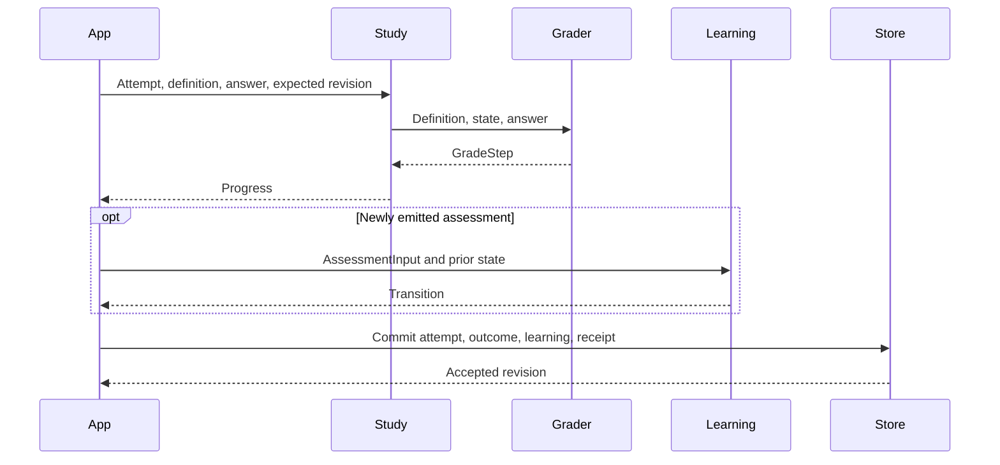

# Reading and extending Tempo 2

The file list is an outline of the concepts. Start with the question you have,
open its named file, read the short module documentation, then read or run the
`#[cfg(test)]` usage scenario in that same file. Root `lib.rs` files and JS barrels
explain the component and expose its public names; they no longer contain the
whole implementation.

This guide accompanies the readability refactor of the pushed
`feat/interface-scaffold` branches. It changes organization, explanations, and
examples while preserving the component contracts and serialized shapes. The
working update branch is `feat/readable-modules`.

## Which component owns my question?

| Question | Open first | Why this is the owner |
| --- | --- | --- |
| Which ID or revision do I need? | [Types README](../tempo-types/README.md), then the matching file under `src/identifiers` or `src/counters` | Shared scalar vocabulary distinguishes meanings without owning domain records |
| What counts as one run through content? | [Study: attempt.rs](../tempo-study/src/attempt.rs), then [progress.rs](../tempo-study/src/progress.rs) | Study owns attempt progression and exactly-once terminal emission |
| How do I add another grading scheme? | [Study: grader.rs](../tempo-study/src/grader.rs) | The associated types let one implementation supply its own definition, state, answer, prompt, and feedback |
| Where does Study obtain content? | [Study: question_source.rs](../tempo-study/src/question_source.rs), then [App: queue_source.rs](../tempo/src/application/queue_source.rs) | Study sees a port; the app adapts Queue and content storage to it |
| Which targets are eligible, and in what order? | [Queue README](../tempo-queue/README.md), then `eligibility.rs` and `queue_policy.rs` | Eligibility and ordering have separate inputs and rules |
| How are related exercises kept together? | [Queue: group.rs](../tempo-queue/src/group.rs), [block.rs](../tempo-queue/src/block.rs), [validate_grouped_order.rs](../tempo-queue/src/validate_grouped_order.rs) | A group constrains presentation without merging learning identities |
| What does Good or Again do to scheduling? | [Learning README](../tempo-learning/README.md), then `assessment_input.rs` and `standard_learning.rs` | Learning interprets outcomes and owns repeat/freshness/scheduler policy |
| Where would a real scheduler replace the fixture? | [Learning: scheduler.rs](../tempo-learning/src/scheduler.rs), then `scheduler_memory.rs` | Scheduler output carries both a due day and versioned algorithm memory |
| What is a chess exercise made of? | [Chess README](../tempo-chess/README.md), then `catalog.rs`, `content_item.rs`, `chess_definition.rs`, `decision.rs` | Chess owns content, expected moves, position identity, and grading |
| What does changing a repertoire mean? | [Chess: plan_import.rs](../tempo-chess/src/plan_import.rs), then `content_change.rs` | Semantic change planning is separate from applying storage writes |
| Which facts must be stored together? | [Store: commit.rs](../tempo-store/src/commit.rs), then [write.rs](../tempo-store/src/write.rs) | An answer's attempt, assessment, learning update, and receipt form one atomic batch |
| What happens on a retried answer command? | [App: submit.rs](../tempo/src/application/submit.rs), [receipts.rs](../tempo/src/application/receipts.rs), [Store: receipt.rs](../tempo-store/src/receipt.rs) | Replay belongs at the command/persistence boundary, before a new transition |
| How are components connected? | [App: components.rs](../tempo/src/components.rs), then [application/mod.rs](../tempo/src/application/mod.rs) | The app owns composition; lower components do not import one another backward |
| What can the UI see and send? | [App views](../tempo/src/views/mod.rs), [commands](../tempo/src/commands/mod.rs), and [UI README](../tempo-core-components/README.md) | Views contain safe presentation; commands carry user intent and expected revision |

These links target the sibling checkouts in the assembled workspace. Each
repository's own README contains links within that repository for GitHub reading.

## Start with these distinctions

**Target → attempt → submission.** A target is a learnable item across time. An
attempt is one run through it. A submission is one answer command within the run.
Retrying an unchanged command preserves its submission ID; a fresh repeat gets a
new attempt ID while retaining the target ID. One multi-decision tactic remains
one target, even though the learner answers several times.

**Content version → response revision → miss revision.** Content version identifies
the semantic definition. Response revision identifies the attempt state a command
expects. Miss revision identifies the generation of misses visible when an
attempt began. They prevent different kinds of stale work; none substitutes for
another.

**Definition → prompt.** The definition can contain the expected answers. A prompt
contains what the learner may see. The grader gets the definition and produces a
safe prompt; the app projects a prompt into a view. Sending the full definition
to a UI would erase this boundary.

**Feedback → new assessment → lifetime outcome.** Feedback describes the latest
answer. `Progress.assessment` says whether this transition emitted a new learning
outcome. `Attempt.terminal` retains the first outcome throughout the run. A
corrected move can have positive feedback while the attempt remains failed and
emits no additional assessment.

**Line → group → block.** A repertoire line helps determine where new content may
be introduced. A group constrains which eligible exercises remain together and
in what internal order. A block is the unit of ordered output. None of them
creates an extra learning target or grants credit for context moves.

**Trait → implementation.** A trait names the interaction a component needs.
An implementation supplies that interaction. For `Grader`, associated types are
the implementation's concrete data shapes: Study does not need an enum containing
every possible subject. Concrete chess content can still use a small enum for its
known grading schemes. The runnable text grader in `tempo-study/src/grader.rs`
and alternate scheduler in `tempo-learning/src/scheduler.rs` demonstrate both
substitution boundaries without a new dependency.

## Follow an answer through the code

The diagram shows runtime calls and returned values. It is separate from the
**compile-time dependency graph** in [ARCHITECTURE.md](ARCHITECTURE.md): returning a
value to a caller does not make the callee depend on that caller.

Read the code in this order: `tempo/src/application/submit.rs`,
`tempo-study/src/submit.rs`, `tempo-chess/src/exact_sequence_grader.rs`,
`tempo-learning/src/standard_learning.rs`, `tempo-store/src/commit.rs`.
The app's receipt lookup and current-content checks happen before the diagram's
new Study transition. If the command was already accepted, its stored result is
replayed instead. Not every answer produces a new assessment or Learning change.

To see this as a complete running journey, open
[study_journeys.rs](../tempo/tests/contracts/study_journeys.rs) or
[submission_recovery.rs](../tempo/tests/contracts/submission_recovery.rs).
The other journeys live beside them in `tempo/tests/contracts`; `contracts.rs`
remains the stable test-target index.

## Use the tests as worked examples

Each Rust file's test names describe the scenario. For a focused run, use
`cargo test -p tempo-study submit::tests` or replace the package/module with the
one you are reading. A single named scenario is a valid filter too. The assertions
show the promised observable result, not just that a value can be constructed.

Simple value wrappers use small consumer examples without importing a richer
component backward. Those examples show how to use a value; they do not claim the
wrapper enforces the owning domain's rules. Enforcement tests live in the owning
operation. For example, `SubmissionId` shows receipt lookup, while the app and
Store check exact replay, command mismatch, and atomicity.

A shared `test_support.rs` holds repetitive setup where useful. Scenario actions
and expectations stay near the concept. Ports include concrete implementation
examples so the connection is visible. Result aliases and compatibility-only
re-export files link to the producing operation's tests instead of duplicating
tests that exercise only a type alias.

UI usage lives in adjacent `*.scenarios.js` files rather than loading a test runner
in production modules. `tempo-core-components/test/study.test.js` collects them
for the existing command. Cross-component Rust and live Rust/UI tests remain
separate because they describe interactions spanning components.

Build the Rust reading surface with `cargo doc --workspace --no-deps --open`.
The full qualification command is `python3 .planning/scripts/qualify_scaffold.py .`;
it runs contract tests, compile examples, formatting, strict Clippy, warning-free
rustdoc, dependency checks, UI scenarios, and the live Rust/UI boundary. Routine
component changes can use the relevant package/scenario instead.

## Keep this shape when adding code

- Name a module for the concept or operation a reader will look for. Keep a
  cohesive algorithm together; use private helper modules where they clarify a
  separate responsibility. There is no arbitrary maximum-file-length rule.
- Begin with purpose, when to use it, who produces/consumes the value, and which
  nearby concept it is easy to confuse with. Document field meaning and invariants
  where the data is defined.
- Keep public root exports stable when moving files. Explicitly label compatibility
  facades, and point to the real definition. Add a dependency only in the direction
  allowed by [contracts/dependencies.json](contracts/dependencies.json).
- Add a real usage scenario beside the concept. Include the setup, action, and
  meaningful expected observation. Use deterministic time/IDs. Do not add a test
  merely to assert that an assigned field equals itself.
- Keep UI wire schemas, serialized storage values, and public interfaces stable
  during readability work. A behavior change deserves its own explicit decision
  and acceptance example.
- Update the component README's concept/file/scenario map when a concept moves.
  Keep [BEHAVIOR.md](BEHAVIOR.md) for shared expectations and
  [VERIFICATION.md](VERIFICATION.md) for what was actually checked.

A compiled component can still be incompatible with another version at runtime.
These boundaries make the contracts visible and testable; they do not prove that
future implementations will satisfy them. Independent component checks and the
small retained integration journeys cover different obligations.
