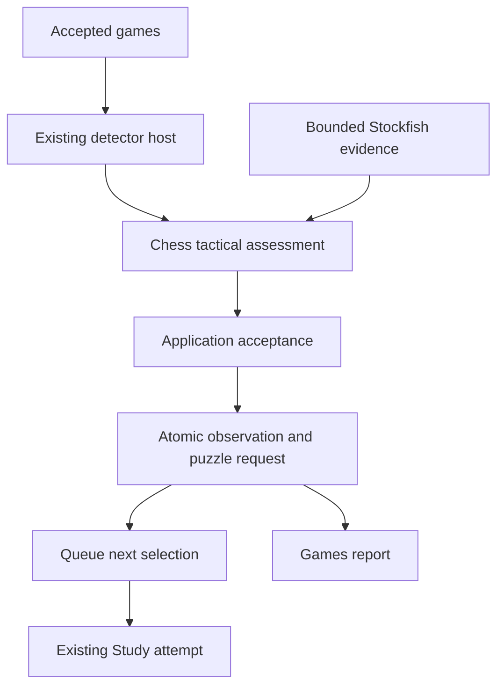

# Hanging material in played games

## Requested behavior

Andy requested this feature on November 20, 2026: inspect every actual learner
decision in retained and newly imported games; record whether hanging material
was captured and whether taking it was a good move; turn every confirmed missed
good capture into a tactical puzzle and place it next after any active exercise.
Captures that are inferior to another move remain comparison cases in Games.

Andy clarified that a puzzle with several possible captures should use
Stockfish's best capture as its single answer. He accepts handling an occasional
questionable card individually. Existing exact-sequence puzzle grading is
therefore retained. A score tie uses deterministic UCI ordering.

## Decisions and owners

| Behavior | Basis and owner | Inputs and independence | Lifetime |
| --- | --- | --- | --- |
| Inspect actual learner turns throughout each accepted game. | Requested whole-game coverage; Chess owns legal timeline and detector facts. | Accepted main line, selected learner and exact move history. No depth-of-opening cap, date requirement, or terminal board without a move. | Source fingerprint and learner bind every scan. |
| Find immediately capturable hanging material. | Initial concrete detector; Chess owns legal candidates. | Legal capture of an opposing nonking unit, including pawns, with no legal immediate recapture of the capturing unit. Defended profitable exchanges are outside this detector. | The algorithm revision is explicit. |
| Compare candidate captures with the best move and actual move. | Requested good-versus-inferior comparison; Chess classifies engine evidence. | Complete exact all-root scores, same-depth iteration, side-to-move perspective, engine/config identity. Initial equivalence tolerance is 30 cp; mate remains a separate score type. Names, labels and detector explanation cannot determine effects. | Results retain analysis provenance; incomplete evidence remains uncertain. |
| Select one answer when several captures are available. | Explicit user clarification; Chess chooses Stockfish's strongest qualifying capture. | Capture scores, deterministic UCI tie break. Good alternative moves in the played game do not become statistical misses. | Existing canonical position plus selected solution identifies puzzle content. |
| Make a missed opportunity a short blind puzzle. | Requested automatic training; Chess compiles a normal one-decision tactic. | Selected capture must also be sound in the standalone puzzle context. No long engine line is required for recognition training. | Reuse existing content/learning when canonical board and answer match. |
| Put a new miss next, preserving the active attempt. | Explicit user priority; Queue owns selection and Learning owns activity mode. | Named durable request, target/version and current learning availability. Daily new limits, theme preference and ordinary repair ordering do not suppress a new urgent request. | Bind the exact request at issuance. A later miss cannot be consumed by an older attempt. |
| Preserve current scheduling cadence. | Existing one-scheduled-Test-per-day contract; Learning owns grading eligibility. | A legal scheduled Test when due/allowed, otherwise immediate blind Practice without an extra FSRS update. A new captured target uses the existing ungraded capture introduction. | Practice remains Practice; no inferred game Again or second scheduler. |
| Accept analysis and training together. | User's every-miss requirement; application coordinates, Store commits. | Typed outcome and puzzle proposal, current source/dataset, catalog and learning values. No policy inferred from strings or display fields. | One transaction for observation, catalog, learning, request and analysis receipt. |
| Count real decisions once. | Requested rates and retry safety; Store owns relational uniqueness. | Source/game/learner/ply/motif is independent of analysis version. Two actual occurrences count twice; the same import or rescan counts once. | Detector upgrades revise observations without replaying fulfilled training. |
| Honor an explicit Skip without suppressing a later new miss. | Existing session deferral plus requested immediate training; Queue owns deferral. | Skip applies to required Practice as well as Test. Only acceptance of a distinct new occurrence request clears it; replay and a revised analysis do not. | A replayed old Skip cannot defer a newer request. |
| Keep the current finding separate from earlier training. | Exact-attempt and receipt preservation; Store owns request binding and UI presents both facts. | A revised analysis can cancel an unissued request. Issued/fulfilled requests retain the original target/version even if the current preferred answer or outcome changes. | Cancelled links are omitted from current presentation; audit rows and old accepted replies remain intact. |
| Resolve an automatic import conflict for the exact validated puzzle. | Every confirmed missed capture must have a puzzle; Chess owns content status. | Only the exact selected board/answer target is reactivated from automatic quarantine. Other conflicting targets, identity, definition, version and learning are retained. | Retired content is not silently restored. A deterministic acceptance failure is recorded and does not block later games. |

The report says what was played. It does not claim to measure conscious
recognition. Multiple loose targets at one decision remain one opportunity.
Counts distinguish good captures, good alternatives, genuine missed good
captures, inferior captures taken/declined, and uncertain results.

## Existing paths extended

No new component repository, scheduler, game importer or detector framework is
introduced. The public `GameDetector` contract and its timeout/worker-ownership
rules remain the execution path. The ordinary detector preview stays read-only;
the separately composed background consumer accepts completed tactical results.
Its version-1 preview wire remains compatible with older strict clients.

Pending accepted games are read in bounded newest-first pages, including
undated games and archives larger than the old 501-game window. Completed
no-op analyses, uncertain observations, failed scans and timeouts are distinct.
Startup resumes work missing a result for the selected analysis version.
Failed/timed-out markers suppress repeated automatic work for that same version;
an engine/configuration revision permits a new scan. There is no manual retry
control in this first release. An unavailable or incomplete evaluation cannot
be counted as a missed opportunity.

## Engine setup

The normal local runtime uses the existing database-adjacent
`maia/venv/bin/python` environment and installed Stockfish. An explicit
`TEMPO_TACTICAL_PYTHON` or `TEMPO_STOCKFISH` path may select the same dependencies
for an isolated development instance. The Python module dependency used in
qualification is `chess==1.11.2`.

The evaluator reuses one owned Python/Stockfish process group, one engine
thread, and a 64 MiB hash. Initial search settings are two million nodes and a
minimum complete depth of 12. Root results include exact scores and measured
depth/nodes. A bounded incomplete search cannot fabricate an error or puzzle.
The host bounds a full game at 120 seconds, and interactive Study remains on its
existing serialized command owner while the engine runs in the detector worker.

## Verification required for this change

- Legal candidate and score fixtures: both colors, pins, checked king, x-ray
  recapture, en passant, promotions, mate, incomplete roots and final nonmoves.
- Several captures produce one ordinary puzzle containing the strongest
  capture; exact existing graders and existing saved states remain unchanged.
- Real Stockfish through the Python protocol and Rust consumer, cancellation,
  process-group cleanup and request correlation.
- An actual accepted miss while an attempt is active leaves it unchanged and
  selects the new puzzle next. An already tested target receives immediate
  Practice without a second daily scheduled grade.
- Same-game retries and revised analyses preserve counts/content/fulfilled
  requests. A new occurrence reuses learning but creates a fresh request.
- An old attempt cannot clear a new request. Lost answer responses and failed
  Next retain the existing exact replay behavior.
- Atomic failure rolls back observation, puzzle and urgency together. Schema
  11 to 12 preserves existing learning, receipts and outstanding attempts.
- More than 501 undated games are discoverable and restart resumes pending work.
- The Games consumer displays actual classifications, source positions and
  queue state, with bounded reads and truthful failure/uncertainty labels.

## Qualification and delivery

The feature is implemented, tested and published as coordinated draft PRs on the
current interface candidate and post-game prototype. The compatible commit/tree
pins and all PR links are in [the release ledger](../STATE.md#hanging-material-candidate--november-20-2026)
and [manifest](../manifest.json), under `hanging-material-2026-11-20`.

| Check | Observed result |
| --- | --- |
| Locked Rust suites for Tempo, Chess, Store, Learning and Queue | 333 passed, 0 failed, 1 explicitly dependency-gated real-engine case omitted from the default run. That real-engine case passed separately. |
| UI suite and production build | 108 passed; 12 focused tactical transport/mounted cases; build passed using the unchanged packed Core 0.2.2 package. |
| Python engine protocol | 17 passed, including real Stockfish root coverage, mate and insufficient-budget cases. |
| Rust engine process lifecycle | Five cases passed; cancellation/restart/all-roots case also passed with real engine dependencies. |
| Final normal-runtime HTTP integration | One passed, zero failed/skipped; six real Stockfish games; 37.933 seconds. Study progress answered in 6.1 ms during a scan on this disposable instance. |
| Architecture and binary examples | Dependency-direction check and locked build of all Tempo binaries/examples passed. |
| Independent review | Chess/engine, Store/Queue settlement, application consumers and UI lifetime paths reviewed; discovered priority, Skip, progress, conflict and revised-result issues repaired and rechecked. |
| Browser walkthrough | Blocked: installed Chromium cannot create its Unix socket in this executor. No screenshot or visual-browser pass is claimed. |

The [actual final HTTP log](final-http.log) records the commands and executable
hash. The HTTP fixture also retains an optional Chromium journey for an allowed
host. Existing Study and content wire formats, graders and recovery envelopes
are unchanged; populated schema 11→12 migration and exact receipt replay after
restart were exercised with disposable SQLite data.

No retained personal dataset was scanned or changed. No PR was merged and no
managed installation was performed. The next release step is the browser
walkthrough on an allowed host, followed by coordinated integration of the
compatible stack and a separately authorized managed installation. The
development executable hash is qualification evidence, not an installed release
claim. Portable export keeps its existing content/learning scope; game-analysis
and request delivery state live in the normal SQLite database.
