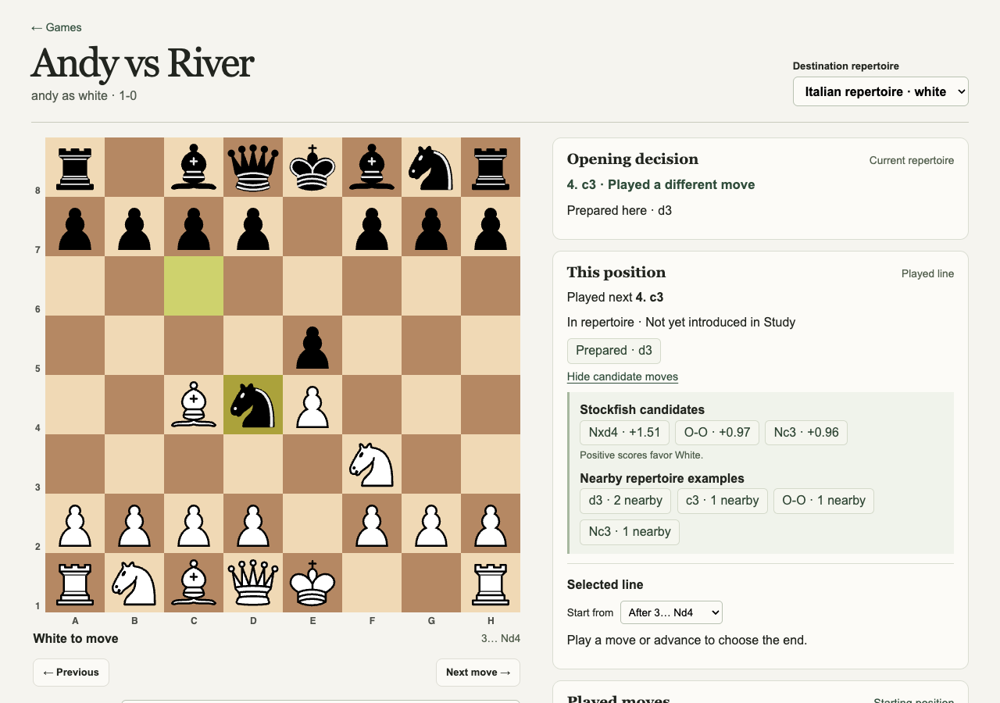

# Post-game repertoire prototype

Open a game and Tempo shows the first opening decision against the chosen repertoire. Click any move to inspect its board, play another move to explore, then preview the line between the selected start and stopping point. A preview lists each saved or new move. A conflicting learner response shows what would be replaced and prevents the add-only save.



## Try it on Andy’s Mac

- [Open the game library](http://127.0.0.1:42684/#games) or [open the empty case](http://127.0.0.1:42686/#games). The local “Open Post-game Prototype.command” in the workspace’s .local/postgame-lab directory restarts the populated demo if necessary and opens its private Chrome profile. The empty launcher works the same way.
- The populated instance contains an Italian repertoire for White, a Caro-Kann repertoire for Black and three completed club games. River is the fourth game, available for you to import. Each evaluator used a different copy.
- Try a recent Italian game of your own, or import the [club game against River](recent.pgn) with Andy as the learner. Pick a response after the unfamiliar move, stop after your chosen reply and save. Close the review and see whether you can tell from Games what you saved and what still needs attention.

## Observed before and after

Two separate GPT-6.2 Astra evaluators began in fresh Chrome profiles with only the task list and PGN. The second evaluator received the same starting fixture on a separate origin. The follow-up to their return-screen finding used their original profile. These are observations of agent operability. Andy’s own attempt is the human usability check.

| Task | Existing experience | Prototype observation |
| --- | --- | --- |
| Find the opening decision | Four history rows read “PGN file game · andy”. The evaluator matched import counts, tried an unconfigured detector and finally inferred the new gap from a separate list. | Review game opened Andy vs River after **3…Nd4**, identified the unprepared opponent move and showed White's next played move, **4.c3**. |
| Inspect another position | Exploration started from a grouped gap. The evaluator could not select an arbitrary move in River’s game. | The reviewer stepped to **4.c3**, tried **4…Nf6 5.cxd4** and could return to the played line. |
| Compare responses | Nearby positions suggested **d3**. The evaluator could not tell whether it was already saved here. | The board identifies the destination. The current-position read, nearby repertoire examples and optional Stockfish candidates are labeled separately. |
| Save a stopping point | Marking a variation worked once the evaluator found the separate analysis board. | The preview listed **3…Nd4 4.c3 Nf6 5.cxd4** and the two new White decisions. The reviewer saved through **5.cxd4**. River’s remaining moves stayed out of the repertoire. |
| Recognize a transposition | A half-move number in a disclosure did not identify the matching board. | Robin’s **2…Nf6** left the authored route. After **3…Nc6**, the reviewer saw the alternate move order and the exact saved **4.d3**. The range control also supports adding the intervening move order through reentry. |
| Understand a conflict | The original marked-line preview named the replaced answer and branches to retire. | Previewing Avery’s **3.Bb5** named the saved **3.Bc4** and the affected continuations. The review offered no destructive save. |
| Review existing preparation | The Study repair showed Bb5 versus Bc4. The Games row supplied a half-move number. | Avery opened on the board before **3.Bb5**, with the prepared reply and its separate Study introduction status. Morgan’s game illustrates continuing after an authored endpoint. |
| Return later | The resolved gap vanished while the game retained its original deviation count. The evaluator could not reconstruct what had been completed. | The first prototype exposed the saved endpoint but hid the remaining move inside the game. After revision, the reviewer read the saved endpoint, their explicit review mark and the outstanding **4…Nxf3+** directly in the library. |

[First evaluator’s notes and screenshots](before/first-visit.md) · [Independent repeat and return-screen follow-up](after/return-visit.md) · [Signed preview](after/return-preview.png) · [Conflict](after/return-conflict.png) · [Final return screen](after/return-updated-library.png) · [Small-screen board](mobile.png)

The position remains fixed while evidence or destinations change. This borrows from Lichess's game analysis board and ChessTempo's position explorer. The separate actions for an existing response and a missing move draw on Chessbook’s game-to-repertoire review. Tempo retains its own learning and acceptance rules. [Lichess game analysis](https://lichess.org/page/blind-mode-tutorial) · [ChessTempo user guide](https://c1b.chesstempo.com/manual/en/manual.pdf) · [Chessbook game comparison](https://wiki.chessbook.com/connected-accounts)

## What was verified

- SQLite comparison immediately after import and after the reviewer's save found exactly two additional learning targets, **4.c3** and **5.cxd4**, both unintroduced. All 18 prior target identities, versions, positions, prescribed responses and learning rows matched. The existing importer updated provenance on 12 content rows. Assessments, attempts, Study receipts, daily allowances, games and historic comparisons matched exactly. One content receipt and one authored line were added. Integrity and foreign keys passed.
- The new read was exercised on alternate move orders, unrelated and opposite-side repertoires, an invalid address, a renamed destination, a changed prescription and an explored move sequence. Pure reads preserved every database table. Importing into a fresh empty instance produced a playable timeline without a destination.
- Chrome exercised the rendered squares, move navigation, alternate routes, add-only selection, blocked conflicts, saved endpoint, review marker, narrow layout and reload. The reviewer returned after a server restart. Stockfish returned candidates from the isolated local runtime.
- The optimized review endpoint returned 40 game boards in 53–133 ms over four local reads, using two repertoire PGNs of 228,606 and 670,244 bytes on a disposable retained-data copy. These are local observations.
- The independent engineer replayed lost-response and unaccepted Games imports and signed repertoire saves from the installed PGN-release executable using a disposable copy of its 2,317-game backup. Each command kept its identity and had one effect. The regular browser recovery envelopes passed. The existing Games browser suite separately exercised large-request recovery. No Study command or receipt shape changed.

## Boundaries

The library groups games from the latest 100 saved comparisons. A game can have several comparisons. Reopening it compares its accepted moves with the selected repertoire as it stands now. A library row’s last comparison is the result observed on the last visit. Other edits can change its result. A browser-local review mark records an explicit decision by the visitor. The same game can still have an unprepared move. Browser-local marks and resume locations do not sync to another profile. The game, accepted PGN and learning records persist in SQLite.

The review describes positions in the selected game and legal moves or routes in a named repertoire. It provides no probability of encountering a move or of covering future games. Stockfish runs on request for the displayed board. The detector registry is empty in this instance. Maia weights and external explorer credentials were not provisioned. Nearby move candidates summarize matching examples. Viewing their underlying boards remains easier in the existing full analysis view. The Games workflow supports additions to a selected, verified repertoire document. Intentional replacements belong in the repertoire editor.

## Reproduce on a compatible checkout

Use the reviewed interface candidate component set in the [manifest](../manifest.json), replacing Tempo, Store and UI with the prototype commits in the [run ledger](../STATE.md#disposable-post-game-repertoire-prototype). Keep the same workspace lock and packed Core dependency. In a separate assembled development workspace, build the UI with `make build-ui` and the backend with `cargo build --release --locked -p tempo`. From that workspace, these commands create a brand-new private database directory, seed it through Tempo’s public commands and print its standalone serve command.

```sh
python3 .planning/plans/usable-release/postgame-prototype/make_demo.py target/release/tempo tempo-ui/dist ./postgame-demo
python3 .planning/plans/usable-release/postgame-prototype/make_demo.py target/release/tempo tempo-ui/dist ./postgame-empty --empty
```

Each serve command picks a free loopback port. Use a separate browser profile for the walkthrough. The UI works with local repertoire evidence alone. Andy’s supplied populated demo also includes the Python chess library in its private engine environment for the existing Stockfish installation. Prototype publication is through draft PRs.
